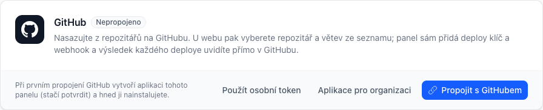
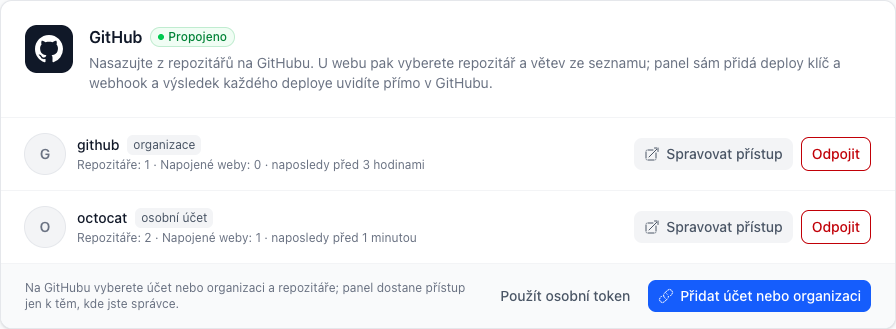
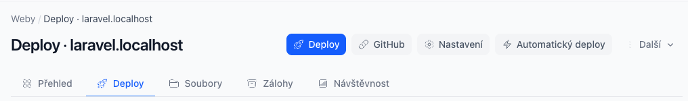
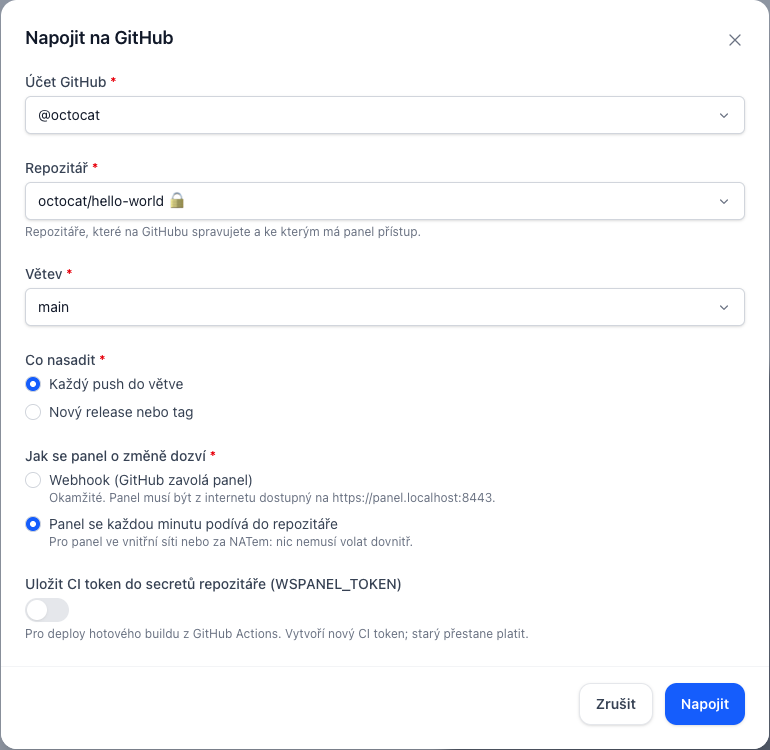
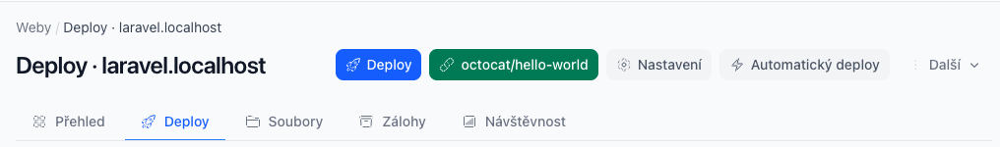

# GitHub: napojení repozitáře jedním kliknutím

Podobně jako v Zerops: připojíte účet GitHub, u webu vyberete repozitář a větev
ze seznamu a panel přes GitHub API nastaví všechno ostatní sám. Nic se nekopíruje
ručně (deploy klíč, adresa webhooku, secret) a výsledek každého deploye vidíte
přímo v GitHubu.

| Co panel udělá | Kde to v GitHubu uvidíte |
|---|---|
| přidá **deploy klíč** webu, jen pro čtení | Settings → Deploy keys → „WSPanel *doména*“ |
| nastaví deploy webu na repozitář (`git@github.com:…`) a větev | – |
| založí **webhook** na push (podepsaný secretem) | Settings → Webhooks |
| nebo místo webhooku každou minutu kontroluje repozitář | – |
| na přání uloží **CI token** jako secret `WSPANEL_TOKEN` | Settings → Secrets and variables → Actions |
| každý deploy nahlásí jako **Deployment** se stavem a odkazy | stránka repozitáře → Deployments / Environments |

Ruční cesty (vlastní Git server, GitLab, Bitbucket, webhook zadaný ručně) dál
fungují, viz [Deploy](deploy.md).

## Návod: první deploy z GitHubu krok za krokem

Celé to zabere pár minut. Potřebujete účet na GitHubu s právy **správce
(Admin)** k repozitáři, který chcete nasazovat.

### Krok 1: Propojit s GitHubem

V panelu otevřete menu účtu (vpravo nahoře) → **Integrace**. Na kartě GitHub
klikněte na **Propojit s GitHubem**.



Stejně dobře můžete začít přímo u webu: **Deploy** → tlačítko **GitHub**.
Po propojení se vrátíte tam, odkud jste přišli.

### Krok 2: Jen poprvé – vytvořit aplikaci panelu (správce)

Když s GitHubem propojuje panel úplně první člověk (správce), GitHub nejdřív
ukáže stránku **Create GitHub App for …** s předvyplněnou aplikací panelu.

- **GitHub App name**: nechte, nebo změňte (musí být na celém GitHubu jedinečný).
- Nic dalšího nevyplňujte. Oprávnění i adresy připravil panel.
- Klikněte na zelené **Create GitHub App for …**.

GitHub předá panelu klíče aplikace a rovnou pokračuje krokem 3. Tento krok už
nikdo další dělat nebude. Klient, který přijde dřív než správce, uvidí
„Propojení tlačítkem zatím nenastavil správce panelu“ (viz
[Nebo připojit tokenem](#2-nebo-připojit-tokenem)).

### Krok 3: Na GitHubu – nainstalovat a vybrat repozitáře

GitHub zobrazí **Install WSPanel …**:

1. Vyberte, kam aplikaci nainstalovat: **váš účet**, nebo **organizaci**.
2. **Only select repositories** a vyberte repozitáře, které chcete nasazovat
   (nebo *All repositories*).
3. Klikněte na **Install** (u nové instalace **Install & Authorize**).
4. Pokud se GitHub zeptá **Authorize WSPanel …**, potvrďte. Panel tím ověří,
   že instalace patří vám.

Vrátíte se do panelu. Na kartě přibude účet s počtem repozitářů:



U organizace, kde nejste vlastník, instalaci musí schválit vlastník. Panel do
té doby napíše „Nic k připojení“; po schválení klikněte na Propojit znovu.

### Krok 4: Napojit web na repozitář

Otevřete web → záložka **Deploy** → tlačítko **GitHub**:



V okně vyberte:

- **Účet GitHub**: když jich máte víc,
- **Repozitář** a **Větev**: nabízí se jen repozitáře, které spravujete,
- **Co nasadit**: každý push do větve, nebo jen nový release / tag,
- **Jak se panel o změně dozví**: *Webhook*, když je panel dostupný z internetu.
  Když běží ve vnitřní síti (`localhost`, `*.lan`, privátní IP), nabídne jen
  *kontrolu každou minutu*: GitHub webhook na adresu, kterou z internetu nevidí,
  odmítne („isn't reachable over the public Internet“),
- **Uložit CI token do secretů**: jen pokud budete nasazovat hotový build
  z GitHub Actions.



Klikněte na **Napojit**. Panel přidá do repozitáře deploy klíč, nastaví deploy
na repozitář a větev a založí webhook (nebo začne repozitář sledovat).

### Krok 5: Hotovo – první deploy

Tlačítko teď ukazuje napojený repozitář:



- **První deploy** spusťte tlačítkem **Deploy**, nebo pushněte do větve
  (vytvořte release, pokud jste zvolili release / tag).
- Průběh vidíte v **Historii** a **Logu** na stránce Deploy.
- V GitHubu se deploy objeví v **Deployments** (pravý sloupec repozitáře)
  s odkazem na web a na log v panelu.
- Migrace, vlastní příkazy po deployi a údržbovou stránku nastavíte v
  **Deploy → Nastavení**.

Další repozitář nebo web napojíte stejně (krok 4). Další účet nebo organizaci
přidáte na stránce Integrace tlačítkem **Přidat účet nebo organizaci**.

## 1. Propojit s GitHubem

Stejně jako v Zerops: kliknete, na GitHubu vyberete účet nebo organizaci
a repozitáře a vrátíte se do panelu. Nic se nekopíruje.

Kde: menu účtu (vpravo nahoře) → **Integrace** → karta **GitHub** →
**Propojit s GitHubem**. Stejné tlačítko je přímo u webu: Deploy → **GitHub**.
Po propojení se vrátíte na stránku, odkud jste přišli.

### Poprvé (správce panelu)

Při úplně prvním propojení GitHub nejdřív vytvoří **aplikaci tohoto panelu**
a hned pak ji nainstalujete. Je to jeden průchod:

1. **Propojit s GitHubem** → panel pošle GitHubu šablonu (manifest) aplikace
   s oprávněními níže.
2. Na GitHubu potvrdíte **Create GitHub App**. Název jde změnit, musí být na
   GitHubu jedinečný.
3. GitHub předá panelu klíče aplikace (ID, client secret, privátní klíč). Panel
   je uloží **šifrovaně**, ručně se nic nevyplňuje.
4. Hned pokračuje instalace: vyberete účet nebo organizaci a repozitáře.

- **Aplikace pro organizaci:** když má aplikace patřit organizaci místo vašeho
  účtu (spravuje ji pak kdokoli z vlastníků organizace).
- **Mám už aplikaci na GitHubu:** aplikace existuje (předání klíčů selhalo, nebo
  jste ji založili ručně). GitHub → Settings → Developer settings → GitHub Apps →
  aplikace: zkopírujte **App ID** a **Client ID**, vygenerujte **client secret**
  a **privátní klíč** (.pem) a vložte je. Panel je ověří u GitHubu.
- Aplikace je **veřejná**, aby ji klienti mohli nainstalovat na své účty. Nic
  jiného, než co je v tabulce oprávnění, neumí, a vlastní webhook nemá.
- Funguje i pro panel ve vnitřní síti (`panel.firma.lan`, `localhost`):
  návraty z GitHubu jdou přes prohlížeč, GitHub panel volat nemusí.

Klient, dokud správce aplikaci nevytvoří, vidí „Propojení tlačítkem zatím
nenastavil správce panelu“ a může použít osobní token (krok 2).

### Další uživatelé a další účty

**Propojit s GitHubem** (nebo **Přidat účet nebo organizaci**, když už nějaký
máte):

1. GitHub otevře instalaci aplikace: vyberete **účet nebo organizaci** a
   **repozitáře** (všechny, nebo jen vybrané).
2. GitHub se zeptá na potvrzení přihlášení (aby panel věděl, že instalace
   patří vám) a vrátí vás do panelu.
3. Na kartě GitHub přibude účet s avatarem, typem (osobní účet / organizace),
   počtem repozitářů a napojených webů.

Panel nabídne jen repozitáře instalace, ve kterých jste na GitHubu
**správce** (deploy klíče a webhooky smí přidávat jen správce repozitáře). Člen
organizace s právy jen pro čtení nebo zápis přes panel víc práv nezíská, i když
instalace obsahuje víc repozitářů. **Spravovat přístup** u účtu otevře nastavení
instalace na GitHubu; po změně klikněte na Propojit s GitHubem znovu a seznam
se obnoví.

Pro každou organizaci připojte zvlášť (Přidat účet nebo organizaci → zvolit
jinou organizaci). U organizace, kde nejste vlastník, instalaci schvaluje vlastník.
Panel pak napíše „Nic k připojení“; po schválení klikněte znovu.

Bezpečnost tohoto toku:

- Každý návrat z GitHubu musí nést náhodný `state`, který panel poslal ve stejné
  relaci. Jinak ho odmítne (403).
- Instalaci panel připojí, jen když GitHub potvrdí, že k ní má přístup právě
  přihlášený uživatel GitHubu (`GET /user/installations` s jeho tokenem).
  Podstrčené `installation_id` nic nepřipojí.
- Panel neukládá žádný trvalý token: pro každé volání si s privátním klíčem
  aplikace (JWT) vyžádá token instalace platný hodinu, drží ho šifrovaně v cache
  a nechá ho vypršet.
- Instalaci panel připojí jen pro repozitáře, které přihlášený uživatel GitHubu
  spravuje (`GET /user/installations/{id}/repositories`, `permissions.admin`).
  Totéž znovu ověří při napojení webu.
- **Odpojit** jen zapomene připojení v panelu. Aplikaci z účtu na GitHubu
  nesmaže, protože instalaci můžou sdílet další uživatelé panelu.
  Odinstalaci provede vlastník účtu na GitHubu (Settings → Applications).

### Oprávnění

Aplikace (i token, pokud ho použijete místo ní) potřebuje tato oprávnění
k repozitářům:

| Oprávnění | Úroveň | Proč |
|---|---|---|
| Administration | Read and write | přidání a odebrání deploy klíče |
| Webhooks | Read and write | založení a odebrání webhooku |
| Deployments | Read and write | hlášení stavu deployů |
| Secrets | Read and write | uložení `WSPANEL_TOKEN` (volitelné) |
| Contents | Read-only | seznam větví |
| Metadata | Read-only | povinné, seznam repozitářů |

## 2. Nebo připojit tokenem

Když GitHub aplikaci nechcete (GitHub Enterprise, zákaz aplikací v organizaci):
**Integrace → GitHub → Použít osobní token**.

GitHub → Settings → Developer settings → **Fine-grained tokens** → Generate new token:

- **Resource owner:** vy nebo organizace, které repozitáře patří,
- **Repository access:** *Only select repositories* a vyberte repozitáře,
- **Repository permissions:** podle tabulky výše,
- **Expiration:** podle vašich pravidel. Po vypršení panel hlásí „GitHub odmítl
  token“ a stačí vložit nový (napojené weby zůstanou).

Panel token ověří (`GET /user`) a uloží šifrovaně. Už se nikde nezobrazí. Funguje
i classic token (`ghp_…`) se scope `repo` a `admin:repo_hook`, ale dává přístup
ke všem repozitářům účtu.

Účet (připojený tlačítkem i tokenem) vidí a používá jen uživatel, který ho
připojil: klient má svůj GitHub, správce svůj.

## 3. Napojit web

Detail webu → **Deploy** → tlačítko **GitHub**:

1. **Účet GitHub**: když jich máte víc.
2. **Repozitář**: repozitáře vybrané při instalaci aplikace, nebo které smí spravovat token (🔒 = privátní).
3. **Větev**: načte se z repozitáře.
4. **Co nasadit**: každý push do větve, nebo nový release / tag (nasadí přesně
   ten tag).
5. **Jak se panel o změně dozví:**
   - **Webhook**: okamžité. Panel musí být z internetu dostupný na své adrese
     (`APP_URL`). Výchozí volba, když panel běží na veřejné doméně.
   - **Kontrola každou minutu**: pro panel ve vnitřní síti, za NATem nebo na
     `*.local`/`*.lan`. Nic nemusí volat dovnitř. Výchozí volba pro neveřejný panel.
6. **Uložit CI token do secretů** (volitelné): pro deploy hotového buildu
   z GitHub Actions. Vytvoří nový CI token (starý přestane platit) a uloží ho
   do repozitáře jako `WSPANEL_TOKEN`, zašifrovaný veřejným klíčem repozitáře.

Ostatní nastavení deploye (migrace, vlastní příkazy, údržbová stránka, počet
releasů) zůstává, jak bylo. Když se kterýkoli krok nepovede (chybí oprávnění,
GitHub nedostupný), panel smaže, co už v repozitáři stihl založit, a web zůstane
nenapojený.

Tlačítko pak ukazuje název repozitáře. Pod ním je **Odpojit**: panel z repozitáře
odebere svůj webhook a deploy klíč, automatický deploy přes webhook vypne
a nastavení deploye nechá.

## Deploye v GitHubu

Každý deploy webu (z tlačítka, webhooku, kontroly repozitáře, z CI i staging →
produkce) se do minuty objeví v GitHubu jako **Deployment** commitu v prostředí
`production`:

- *in progress* → *success*, nebo *failure* (selhal nebo se vrátil zpět),
- **View deployment** vede na web, **log** na stránku Deploy v panelu,
- starší deploye v prostředí GitHub označí jako neaktivní.

Hlásí se jen deploye od napojení. Build nahraný z CI s commitem, který
v repozitáři není (lokální build), se přeskočí. GitHub ho nezná.

## GitHub Actions s hotovým buildem

S uloženým `WSPANEL_TOKEN` stačí ve workflow nahrát balík (vzor najdete
v Deploy → Další → GitHub Actions / CI, včetně doplněné adresy):

```yaml
on:
  release:
    types: [published]
jobs:
  deploy:
    runs-on: ubuntu-latest
    steps:
      - uses: actions/checkout@v4
      - run: composer install --no-dev --optimize-autoloader
      - run: npm ci && npm run build
      - run: tar --exclude=.git --exclude=node_modules -czf /tmp/build.tar.gz .
      - run: |
          curl -fsS -H "Authorization: Bearer ${{ secrets.WSPANEL_TOKEN }}" \
            -F artifact=@/tmp/build.tar.gz -F ref=${{ github.ref_name }} -F commit=${{ github.sha }} \
            https://panel.example.com/api/deploy/<id>/artifact
```

V tom případě v okně GitHub nechte „Jak se panel dozví“ na kontrole repozitáře
a v Automatickém deployi ho vypněte. Jinak by se release nasadil dvakrát (jednou
z CI, jednou z gitu). Postup pro skutečný projekt (privátní Composer balíčky,
`.env` z GitHub vars) je v [Nasazení existujícího projektu](nasazeni-projektu.md).

## Bezpečnost

- Klíče GitHub aplikace i vložené tokeny jsou v databázi panelu šifrované
  (`APP_KEY`), ven se nepošlou a v UI se nezobrazí. U aplikace panel pracuje jen
  s hodinovými tokeny instalací.
- Deploy klíč je **jen pro čtení** a patří jen tomuto webu (každý web má svůj).
- Webhook je podepsaný secretem webu a panel přijme každé doručení jen jednou.
- Účet GitHub patří uživateli: klient nepoužije účet správce ani jiného klienta.
- Odpojení účtu odebere webhooky a klíče ze všech jeho napojených repozitářů.

## Problémy

| Hláška | Co s tím |
|---|---|
| GitHub odmítl token | token vypršel nebo byl zrušen; vložte nový (Integrace → GitHub → Použít osobní token) |
| „Neplatný nebo prošlý návrat z GitHubu“ | návrat z GitHubu z jiné relace nebo podruhé; klikněte na Připojit GitHub znovu |
| „Nic k připojení“ | instalaci v organizaci musí schválit vlastník, aplikace u účtu není nainstalovaná, nebo v instalaci nespravujete žádný repozitář |
| „nemáte na GitHubu práva správce“ | k repozitáři nemáte roli Admin, nebo ho instalace nezahrnuje; po změně klikněte na Propojit s GitHubem znovu |
| „This page has expired“ po kliknutí na tlačítko v tabulce | opraveno (tlačítka v hlavičce tabulek volala neexistující metodu); aktualizujte panel |
| GitHub hlásí „Invalid GitHub App configuration“ | starší panel posílal v manifestu webhook aplikace s lokální adresou, kterou GitHub odmítne; aktualizujte panel a klikněte na Propojit s GitHubem znovu |
| „GitHub aplikaci se nepodařilo dokončit … HTTP 503/504“ | aplikace na GitHubu vznikla, jen GitHub (přetížený) nevydal její klíče. Na stránce Integrace klikněte na **Dokončit vytvoření aplikace** (kód platí hodinu). Po hodině použijte **Mám už aplikaci na GitHubu** a zadejte App ID, Client ID, nový client secret a privátní klíč z nastavení aplikace. Aplikaci nezakládejte znovu |
| GitHub aplikace se nepodařila vytvořit | název aplikace je na GitHubu obsazený (změňte ho na stránce GitHubu), nebo kód vypršel (opakujte) |
| Token nemá přístup k repozitáři nebo mu chybí oprávnění | v nastavení tokenu přidejte repozitář do *Repository access* a zkontrolujte tabulku oprávnění výše |
| `key is already in use` | klíč webu už je v repozitáři (přidaný dřív ručně) nebo v jiném repozitáři jako deploy klíč, což GitHub nedovolí; odeberte ho tam (Settings → Deploy keys) a napojte znovu |
| Repozitář chybí v seznamu | u aplikace: Spravovat přístup → přidat ho do instalace, pak Propojit s GitHubem znovu; u tokenu: *Repository access* nebo chybí práva správce. Seznam se obnovuje po 5 minutách |
| „GitHub odmítl adresu webhooku: panel není dostupný z internetu“ | panel běží na adrese, kterou GitHub nevidí; zvolte kontrolu repozitáře každou minutu (deploy proběhne do minuty po pushi) |
| Webhook v GitHubu hlásí chyby doručení | panel není z internetu dostupný; přepněte na kontrolu každou minutu (GitHub → Napojit znovu) |
| Deploy se v GitHubu neukazuje | build z CI s commitem, který v repozitáři není, se přeskočí; jinak počkejte minutu (hlásí se při `panel:sync`) |
